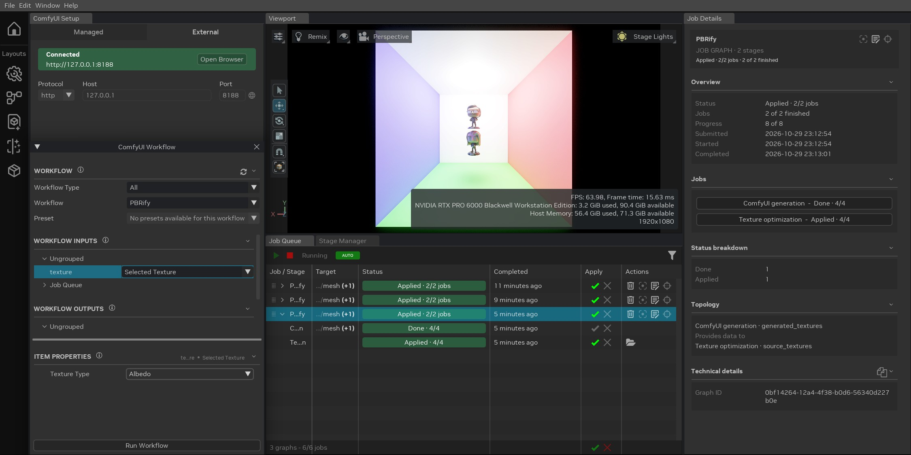
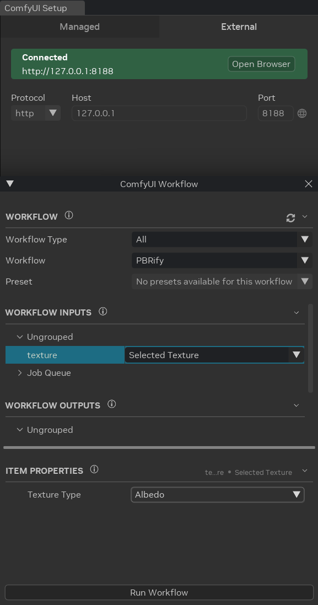
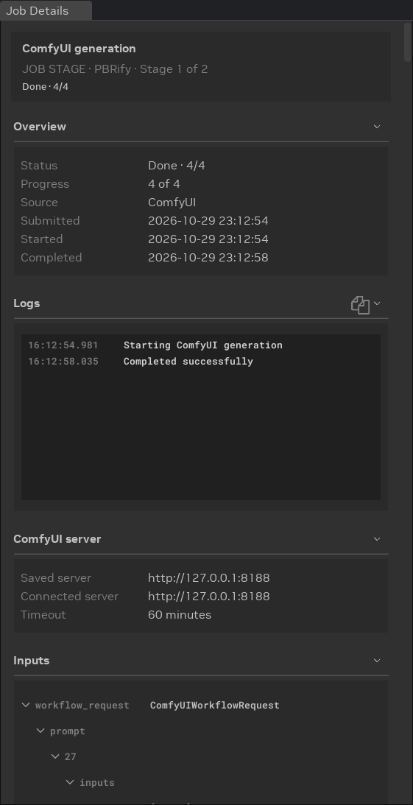
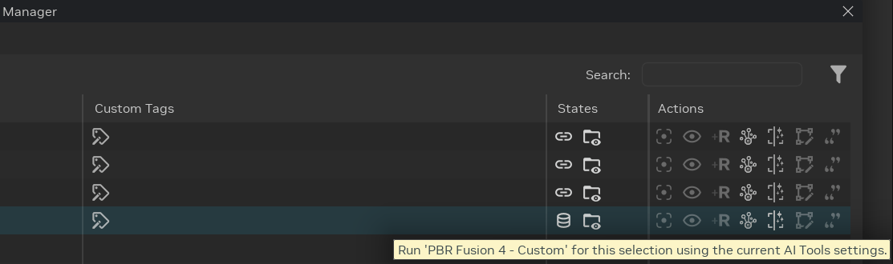
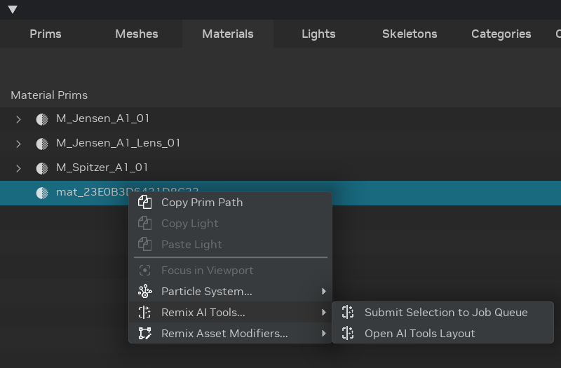

# Using AI Tools

The RTX Remix Toolkit AI Tools integrate [ComfyUI](https://github.com/comfyanonymous/ComfyUI), an open-source,
node-based workflow engine. ComfyUI runs the AI workflows. The Toolkit lets you configure and submit those workflows,
monitor their progress, and apply their results to your USD stage.

You can use compatible ComfyUI workflows for tasks such as PBR texture generation, upscaling, style transfer, and mesh
processing. The fields shown in the Toolkit come from the inputs and outputs that the workflow author tagged for RTX
Remix.

AI Tools is useful for modders, small teams, and rapid prototyping. For example, AI-generated PBR maps can help
non-artists create usable textures while experienced artists focus on hero assets.

## Getting Started

### Prerequisites

- **GPU:** An NVIDIA GPU with at least 8 GB of VRAM (12 GB or more recommended).
- **[ComfyUI](#installing-comfyui):** A working ComfyUI installation.
- **[ComfyUI Manager](#installing-comfyui-manager):** Used to install nodes and models.
- **[RTX Remix Node Pack](#installing-the-rtx-remix-node-pack):** Required for workflows that expose inputs and
  outputs to the Toolkit.
- **[Template workflow preparation](#preparing-template-workflows):** Missing custom nodes must be installed before
  you use a bundled template workflow.

### Installing ComfyUI

ComfyUI can be installed in several ways:

- **Desktop App (recommended):** Download the [ComfyUI Desktop App](https://www.comfy.org/download) for a managed
  installation with automatic updates.

  ```{note}
  The Desktop App bundles its own Python environment. When exporting workflows, use the right-click
  "Export Workflow for RTX Remix" option rather than the API export, as the Desktop App's export format may differ.
  ```

- **Portable (Windows):** Download a portable release from the
  [ComfyUI releases page](https://github.com/comfyanonymous/ComfyUI/releases). Extract and run
  `run_nvidia_gpu.bat`.

- **Manual:** Clone the [ComfyUI repository](https://github.com/comfyanonymous/ComfyUI) and follow the manual
  installation instructions.

  ```{warning}
  Avoid installation paths containing spaces. Some ComfyUI nodes may fail to resolve paths correctly.
  ```

### Installing ComfyUI Manager

[ComfyUI Manager](https://github.com/Comfy-Org/ComfyUI-Manager) provides the easiest way to install custom nodes and
models, including the RTX Remix Node Pack and any dependencies required by your workflows.

ComfyUI Manager comes **pre-installed with the Desktop App**. For Portable or Manual installations, install it
manually:

1. Navigate to `ComfyUI/custom_nodes/` in your ComfyUI installation.
2. Clone the repository:

   ```bat
   git clone https://github.com/Comfy-Org/ComfyUI-Manager.git
   ```

3. Restart ComfyUI.

### Installing the RTX Remix Node Pack

The [RTX Remix Node Pack](https://github.com/NVIDIAGameWorks/ComfyUI-RTX-Remix) provides nodes for tagging workflow
inputs and outputs, saving textures with type metadata, and exporting workflows for the Toolkit. Install it through
ComfyUI Manager:

1. Open ComfyUI in your browser.
2. Open the ComfyUI Manager (the **Manager** button in the top menu bar).
3. Search for **RTX Remix** in the search field of the ComfyUI Manager.
4. Find **NVIDIA RTX Remix Nodes** in the search results, then click its **Install** button.
5. Accept the restart when ComfyUI asks you to restart the backend.
6. Click the **Templates** button in the left sidebar after the restart.
7. Scroll to the bottom of the left panel, then click **ComfyUI-RTX-Remix**. The template workflows of the node pack
   appear.
8. Check the installation status in the ComfyUI Manager and the ComfyUI backend startup log for import errors if the
   templates do not appear.

```{note}
Requires ComfyUI v0.3.72 or newer (V3 schema API support).
```

### Preparing Template Workflows

The RTX Remix Node Pack ships with ready-made template workflows. These templates may depend on additional custom nodes
that are not installed by default. Before using a template for the first time, install its dependencies:

1. Open ComfyUI in your browser.
2. Click **Templates** in the left sidebar.
3. Scroll to the bottom of the left panel and click **ComfyUI-RTX-Remix**.
4. Click on the template workflow you want to use. The workflow loads onto the canvas.
5. If the **This workflow has missing nodes** dialog appears, click **Skip for Now**. You will install the listed
   nodes through ComfyUI Manager in the next step.
6. Open **ComfyUI Manager** (the **Manager** button in the top-right area of the menu bar).
7. Click **Install Missing Custom Nodes**.
8. Select all listed nodes and click **Install**.
9. After installation completes, click **Restart** to reboot the ComfyUI server.

Once the server restarts, reopen the template workflow. All nodes should load without errors.

```{note}
When you reopen a template, ComfyUI may prompt you to download missing AI models. You can safely **dismiss this
prompt** — the RTX Remix templates include downloader nodes that fetch the required models automatically the first
time the workflow runs. This initial download can take a while depending on your connection speed and the size of
the models. Subsequent runs use the cached models and start much faster.
```

```{tip}
You only need to do this once per template. After the required custom nodes are installed, the template will load
cleanly in future sessions.
```

### Running ComfyUI

ComfyUI must be running and accessible over HTTP for the Toolkit to connect. How you start it depends on your
installation method:

- **Desktop App:** Launch the application. ComfyUI starts automatically. Use the local URL shown by the Desktop App;
  the app can manage the port for the selected installation.
- **Portable:** Run `run_nvidia_gpu.bat` from the ComfyUI directory. The server starts on port `8188` by default.
- **Manual:** Run `python main.py` from the ComfyUI directory. The server starts on port `8188` by default. Use
  `--port` to specify a different port.

```{important}
ComfyUI's default port is **8188**, but the Desktop App or custom launch settings may use another port. Paste the
complete URL for the running ComfyUI instance into the Toolkit's **Host** field; the Toolkit automatically fills the
**Protocol**, **Host**, and **Port** settings.
```

````{tip}
Several template workflows download large AI models from [HuggingFace](https://huggingface.co/) on first run.
Anonymous downloads are rate-limited and can be slow. Set an `HF_TOKEN` environment variable to improve download
speeds.

1. Generate a free read-only token from [your HuggingFace settings](https://huggingface.co/settings/tokens).
2. Export it **before launching ComfyUI**:

   ```bat
   REM Set the environment variable in the Windows console
   set HF_TOKEN=hf_xxxxxxxxxxxxxxxxxxxx
   ```

   or

   ```powershell
   # Set the environment variable in PowerShell
   $env:HF_TOKEN = "hf_xxxxxxxxxxxxxxxxxxxx"
   ```

   Use the first command in Windows Command Prompt, or the second in Windows PowerShell.

3. Start ComfyUI from that shell.

For the Desktop App (or if you prefer per-workflow control), you can instead paste a token into the `hf_token` field
on each `RTX Remix Download Model` node — but the environment variable approach covers every node at once.
````

### Connecting the Toolkit to ComfyUI

1. Click the **AI Tools** button in the left sidebar (in the **Layouts** group) to open the AI Tools layout.

   

   The layout has these windows:

   - **ComfyUI Setup** connects the Toolkit to ComfyUI.
   - **ComfyUI Workflow** selects the workflow, sets its inputs and outputs, and holds **Run Workflow**.
   - The **Job Queue** below the viewport lists the submitted jobs. See [Job Queue](../toolkitinterface/remix-toolkitinterface-jobqueue.md).
   - **Job Details** on the right shows the selected job.

2. In **ComfyUI Setup**, open the **External** tab. The **Managed** tab is not available yet.
3. Paste the complete URL into the **Host** field. The Toolkit automatically sets the **Protocol**, **Host**, and
   **Port** fields:
   - If ComfyUI is using its default port: `http://127.0.0.1:8188`
   - If the Desktop App shows another local URL, paste that URL instead.
4. Click **Connect** at the bottom of **ComfyUI Setup**.
5. The connection banner shows **Connected** when the Toolkit verifies the connection. The **Workflow** dropdown then
   lists the available workflows.



```{note}
The parsed Protocol, Host, and Port settings are persisted across sessions. You only need to paste the URL again when
your ComfyUI setup changes.
```

The connection banner explains the current connection state. The button at the bottom of **ComfyUI Setup** changes with
it:

| Banner | Button | Meaning |
|--------|--------|---------|
| **Disconnected** | **Connect** | Paste the complete URL into **Host**, then select **Connect**. |
| **Connecting** | **Connecting...** | The Toolkit is checking the configured server. |
| **Connected** | **Disconnect** | The banner shows the verified ComfyUI URL. Select **Open Browser** in the banner to open ComfyUI in your browser. |
| **Connection Failed** | **Retry** | Paste a corrected URL into **Host** if needed, then select **Retry**. Select **Show Logs** in the banner to see the endpoint and the connection error. |
| **Connection Unavailable** | **Disconnect** | The Toolkit lost the verified ComfyUI endpoint. Select **Disconnect**, then **Connect** again. |

The **Protocol**, **Host**, and **Port** fields are locked while the Toolkit connects and while it is connected. Select
**Disconnect** before you paste another URL. The globe icon beside **Port** sets the standard port of the protocol
(80 for HTTP, 443 for HTTPS).

**Show Logs** opens a window with the endpoint and the connection error that the Toolkit captured, which you can copy.
It does not show the console or the logs of the ComfyUI server.

## Basic Usage: Running Your First Workflow

### How a Job Is Processed

Each submitted job is a **job graph** in the [Job Queue](../toolkitinterface/remix-toolkitinterface-jobqueue.md).
The graph row shows the display name of the workflow, and the **Target** column shows the prims that the job changes.
The graph stages depend on the tagged workflow outputs.

- A texture workflow runs **ComfyUI generation**, then **Texture optimization**, which converts the textures and holds
  the Apply result.
- A mesh workflow runs **ComfyUI generation**, **Optimization preparation**, **Texture optimization**, and
  **Mesh optimization**. The last stage holds the Apply result.

The graph changes the project only at its Apply step. A failed stage leaves the project unchanged.

Click the arrow at the start of a graph row to show its stages. The **Texture optimization** stage row has
**Reveal in File Explorer**, which opens the folder of the processed textures.

### Selecting a Workflow

The **Workflow** dropdown lists all RTX Remix-compatible workflows available on the connected ComfyUI instance by
their display names. The dropdown shows workflows in two sections. **Built-in** holds the workflows that the node pack
supplies. **User** holds the workflows that you exported. Hover over a workflow to see its description. Select a
workflow to load its configurable fields.

Use the **Workflow Type** dropdown to show only the workflows of one type. The workflow author selects the type at
export. The dropdown groups the types by category:

| Category | Workflow types |
|----------|----------------|
| **Generation** | **Asset Generation**, **Material Generation** |
| **Upscaling** | **Asset Upscaling**, **Mesh Upscaling**, **Texture Upscaling** |
| **Miscellaneous** | **Asset Tagging** |
| **Other** | **Other** |

Hover over a type to see the description that the node pack gives for it. A workflow with a type that the Toolkit does
not know shows only under **All**.

Click the **Refresh** icon to reload the workflow list. Refresh also reloads the selected workflow, so the inputs and
outputs of a re-exported workflow appear.

### Using Presets

When a workflow defines presets, the **Preset** dropdown becomes available. A preset provides a combination of field
values for a specific use case, such as a material type.

Selecting a preset resets every field to its default value before applying the preset's values. If you then change a
field manually, the preset is no longer selected, but your field values remain.

```{tip}
Presets are defined by workflow authors in ComfyUI. The presets available depend entirely on the workflow you select.
Different workflows may offer different presets, or none at all. See
[Managing Presets](https://github.com/NVIDIAGameWorks/ComfyUI-RTX-Remix?tab=readme-ov-file#managing-presets) in the
RTX Remix Node Pack documentation for details on creating and managing presets.
```

### Configuring Workflow Items

The **Workflow Inputs** list shows each tagged workflow input. The **Workflow Outputs** list shows each tagged
workflow output by its export name. Hover over an output row to see its output kind. Both lists group and order their
rows by the groups set in the workflow export. Select an item in either list to show its settings under
**Item Properties**. Input fields can use a text box, numeric control, checkbox, dropdown, or file path.

The **Job Queue** group in **Workflow Inputs** holds the [job timeout](#setting-the-job-timeout). To restore the values
of a preset, select the preset again.

### Sending Scene Data to ComfyUI

Some workflow inputs can read data from your Remix scene instead of using a fixed value:

1. In **Workflow Inputs**, find the input that you want to configure.
2. Open the dropdown beside the input and choose how it gets its value.
3. Select the input row, then configure the options of that choice in **Item Properties**.

| Choice | Input type | Value sent to ComfyUI | Options |
|--------|------------|-----------------------|---------|
| **Constant** | All | One fixed value or file. It does not read the stage. The dropdown names it after the value type: **Text Constant**, **Integer Constant**, **Number Constant**, **Boolean Constant**, or **File Path Constant**. | The value |
| **Selected Texture** | Texture | The texture of each selected material | **Texture Type** |
| **All Textures** | Texture | The texture of each material in the stage | **Texture Type**, **Introducing Layer** |
| **Selected Mesh** | Mesh | The model of each selected mesh | **Reference Selection** (default **Selected**) |
| **All Meshes** | Mesh | The model of each mesh in the stage | **Reference Selection** (default **All**) |
| **Selected Prim** | Text | The path of the prim that each job processes. A workflow with a mesh output, or with a **Selected Mesh** or **All Meshes** input, sends the mesh prim. Other workflows send the material, also when you select a mesh. | None |
| **Current Layer** | Text | The identifier of the root layer of the stage | None |

- **Texture Type** sets the material texture to read, for example **Albedo** or **Roughness**.
- **Introducing Layer** sets which textures **All Textures** processes. **Capture** processes only the textures from
  the game capture. **Mod** processes only the textures that your mod added. **Any** processes all textures.
- **Reference Selection** sets which references of a mesh the workflow uses. **Selected** uses only the reference that
  composes the prim you picked. **All** uses every reference of the mesh.

The available choices depend on the input type. Values are resolved when you submit the job.

The inputs control how many jobs one submission creates:

- If every input is a **Constant** or **Current Layer**, the submission creates one job. The selection has no effect.
  The Toolkit processes the result but does not apply it, because no input points to a stage prim.
- If an input is **Selected Texture**, **Selected Mesh**, or **Selected Prim**, the submission creates one job for
  each selected item.
- If an input is **All Textures** or **All Meshes**, the submission creates one job for each matching stage item.

Items that send the same request to ComfyUI share one job. For example, two meshes that bind the same material share
one texture job. Two meshes that reference the same model with the same inputs share one model job. The Toolkit
applies the shared result to each item.

When a workflow has a mesh input, its texture inputs must use the same scope. A **Constant** mesh needs **Constant**
textures. **Selected Mesh** needs **Selected Texture**. **All Meshes** needs **All Textures**. Submission rejects
other combinations.

A workflow with a **Selected Mesh** or **All Meshes** input and texture outputs reads the model from each mesh
reference. Its textures replace the textures of the materials under that mesh.

### Configuring Workflow Outputs

Select a tagged output in **Workflow Outputs**. Configure these properties:

- Every output has **Apply Behavior**. Select **Do Nothing** to publish processed files without changing the stage.
- A texture output supports **Replace** and **Do Nothing**. **Texture Type** controls texture processing and replacement.
- A mesh output supports **Replace** (default with a mesh input), **Append** (default without), and **Do Nothing**.

Replace removes the source references that the mesh input's **Reference Selection** picked and adds the generated
model in their place. With **All**, every reference of the selected prim gets its own job, and each job replaces the
reference it started from. Append adds the generated model beside each target reference. Replace needs a mesh input
set to **Selected Mesh** or **All Meshes**. Submission rejects Replace when the mesh input is a **Constant**, because
there is no stage reference to replace.

### Setting the Job Timeout

The **Job Queue** group in **Workflow Inputs** has a **Timeout** field. It sets the maximum time in minutes that a job
waits for ComfyUI. The default is 60 minutes. Type `0` to remove the time limit. Each job keeps the timeout that was
set when you submitted it.

When a job times out, the Toolkit cancels its prompt on the ComfyUI server. The next ComfyUI job starts only after the
server confirms the cancellation, so a timed-out prompt cannot slow the jobs after it. The job queue then shows
**Timed Out**.

### Submitting a Job

1. If the workflow has a **Selected** input, select one or more prims in the viewport or Stage Manager. **All**,
   **Constant**, and **Current Layer** inputs do not use the selection.
2. Configure the workflow fields.
3. Click **Run Workflow**. Hover over the button to see why it is unavailable, for example when ComfyUI is not
   connected, no workflow is selected, or no project is open.
4. The **Preparing ComfyUI Jobs** window shows the progress while the Toolkit reads the stage. Click **Cancel** to stop
   without adding jobs.
5. If some items do not provide the inputs that the workflow requires, the Toolkit does not add jobs for them. The
   other jobs go to the queue. If no item is valid, the **No ComfyUI Jobs Created** dialog tells you that no jobs were
   added.

The jobs start as soon as the [Job Queue](../toolkitinterface/remix-toolkitinterface-jobqueue.md) scheduler runs, which
it does by default. If the toolbar shows **Stopped**, click **Start** (▶️).

### Applying Results

**Apply** performs the actions configured on the tagged outputs. Texture Replace updates shader inputs. Mesh Append or
Replace updates model references. **Revert** restores the previous values without deleting the processed files.

By default the Job Queue is in **AUTO** mode and applies each result as soon as it is ready. Click the **AUTO** badge
in the Job Queue toolbar to switch to **MANUAL**, then review each result and select **Apply** (✔️) or
**Decline** (✖️) yourself. See [Applying Results](../toolkitinterface/remix-toolkitinterface-jobqueue.md#applying-results)
for the buttons and their states.

```{tip}
**AUTO** is useful for large batch runs where you want results to land on the stage as soon as they're ready. For more
deliberate workflows, switch to **MANUAL** and apply jobs individually after reviewing them.
```

### Managing AI Tools Jobs

The [Job Queue](../toolkitinterface/remix-toolkitinterface-jobqueue.md) page describes the columns, statuses, filters,
and actions of every job. AI Tools jobs add these actions to their graph row:

- **Focus in Viewport** selects the prims of the job and frames them in the viewport. Click it again to go to the next
  prim.
- **Open Workflow** loads the saved workflow and input values of the job into **ComfyUI Workflow**. The workflow shows
  under **Saved Job** in the **Workflow** dropdown. Change the values and run the workflow again.
- **Retarget** sends a queued job to the ComfyUI server that is now connected, when that server is different from the
  saved server. Confirm with **Change Server**. It is available only while the **ComfyUI generation** stage waits in
  the queue.

A **ComfyUI generation** stage shows **Waiting** while the ComfyUI server that it was submitted to is not connected.
Hover over the status to see the server address.

**Stop** replaces **Delete** on the graph row while a job runs. It cancels the prompt on the ComfyUI server. The job
shows **Stopped** only after the server confirms that the prompt stopped. The next queued ComfyUI job then starts.
While the job waits for that confirmation, **Stop** is unavailable. An optimization stage shows **Running** until its
current step finishes, and then shows **Stopped**.

A **Timed Out** or **Stopped** stage has **Retry** in its row. Retry runs the job again with the same inputs and the
same timeout.

A stage can show **Skipped**. Hover over the status to see the reason. For example, the optimization stages skip an
asset that is already optimized, and the job can still apply the result.

### Job Details

Select a graph or a stage to show it in the **Job Details** window. The
[Job Details](../toolkitinterface/remix-toolkitinterface-jobqueue.md#job-details) section of the Job Queue page lists
every section.



A **ComfyUI generation** stage adds the **ComfyUI server** section:

- **Saved server:** the server that the job was submitted to.
- **Connected server:** the server that the Toolkit is connected to now, or **Not connected**.
- **Timeout:** the job timeout, or **No timeout**.

A **Texture optimization** stage adds the **Processed textures** section with the converted textures.

## Processing at Scale

### Processing the Whole Stage

To process every texture or mesh of your mod in one submission, use the **All** choices:

1. Set the texture input to **All Textures**, or the mesh input to **All Meshes**. A workflow with both inputs must use
   **All** for both.
2. For **All Textures**, set **Introducing Layer**. Select **Capture** to remaster the original game textures. Select
   **Mod** to process only the textures that your mod added.
3. Click **Run Workflow**. You do not need to select prims.

The submission creates one job for each matching stage item. Use **Selected Texture** or **Selected Mesh** to try the
workflow on a few items first.

```{tip}
Set **Auto** in the job queue toolbar to apply each result when it is ready. Increase **Timeout** if one generation can
take longer than 60 minutes on your hardware.
```

### Job Persistence

The job queue is stored in a SQLite database and survives application restarts. If you close the Toolkit while work is
queued, the jobs remain available. Reconnect to ComfyUI and start the scheduler to continue processing them.

### Stage Manager Integration

You can submit jobs directly from the Stage Manager without switching to the AI Tools layout. The **Actions** column of
the **Prims**, **Meshes**, **Materials**, **Categories**, and **Custom Tags** tabs has an **AI Tools** icon. Click it to
submit the selected prims with the current workflow and field values.



The icon is enabled when ComfyUI is connected, a workflow is selected, and the workflow has at least one
**Selected Texture** or **Selected Mesh** input. Its tooltip names the workflow. Otherwise the icon is disabled, and
its tooltip says why: **Constant**, **All Meshes**, and **All Textures** inputs do not use the selection. Click the
disabled icon to open the AI Tools layout.

You can also right-click a prim and select **Remix AI Tools...**:

- **Submit Selection to Job Queue** submits the selected prims, like the icon.
- **Open AI Tools Layout** opens the AI Tools layout.



After a submission, a notification confirms that the selection was added to the job queue. Select
**Open AI Tools layout** in the notification to see the jobs. Selected prims that do not provide the required inputs do
not create jobs. If no selected prim provides them, the Toolkit shows a dialog and adds no jobs.

```{tip}
Submit from the **Materials** tab in the Stage Manager to apply results at the Material prim level. This creates an
override on the Material that all meshes sharing that material will inherit, so you only need to process each
material once rather than per-mesh.
```

## Creating Custom Workflows

The [RTX Remix Node Pack](https://github.com/NVIDIAGameWorks/ComfyUI-RTX-Remix) documentation covers the full workflow
creation process:

1. **Build your workflow** in ComfyUI using standard nodes.
2. **Tag inputs and outputs** for RTX Remix by right-clicking nodes and selecting "Tag for RTX Remix". Tagged inputs
   appear as configurable fields in the Toolkit UI. Tagged outputs tell the Toolkit how to handle results. An output
   node must have a STRING output that holds a file path, for example `RTX Remix Save Texture` or `USD Save Stage`.
   The export adds an `RTX Remix Output File` node that publishes that path. Each tagged output gives one final file.
3. **Export** by right-clicking the canvas and selecting "Export Workflow for RTX Remix". In the export dialog:
   - Enter a **Display Name** and select a **Workflow Type**. Both are required. The **Description** is optional and
     becomes the workflow tooltip in the Toolkit.
   - Select a **Texture Type** for each `texture_file_path` output, also when the workflow has only one.
   - Optionally drag rows and set a **Group** to order the inputs and outputs. Inputs and outputs have separate
     group lists.

   **Export** stays disabled until each required field has a value.

For a mesh workflow, tag a `USD Open Asset` node as the mesh input. Tag an `RTX Remix Export Mesh` or `USD Save Stage`
node as the mesh output. These nodes use the `mesh_file_path` type when you tag them. Do not use the built-in `Load 3D`
and `Save 3D Model` nodes, because they do not read or write USD. A workflow can have only one mesh output.

```{warning}
The standard "Save (API Format)" export does not include RTX Remix metadata. Always use the RTX Remix-specific
export option.
```

See the
[Integration Workflow Guide](https://github.com/NVIDIAGameWorks/ComfyUI-RTX-Remix?tab=readme-ov-file#integration-workflow-guide)
for step-by-step instructions on tagging, exporting, and testing workflows.

## Run Configurations

### Single Machine

The simplest setup: ComfyUI and the RTX Remix Toolkit run on the same machine. In the **External** tab, paste the local
URL used by the running ComfyUI instance into **Host** (for the standard default, `http://127.0.0.1:8188`). The Toolkit
fills the separate connection fields automatically. This is ideal for individual modders and small projects.

```{note}
ComfyUI and the Toolkit share GPU resources on a single machine. If you experience slow inference or VRAM pressure,
consider closing the project before submitting large batches, or use a remote configuration.
```

### Remote Machine

Run ComfyUI on a separate machine (e.g., a dedicated GPU server) to free the local GPU for viewport rendering:

1. Start ComfyUI with the `--listen` flag on the remote machine so it accepts external connections:

   ```bat
   python main.py --listen
   ```

2. In the Toolkit's **External** tab, paste the complete remote URL into **Host** (for example,
   `http://192.168.1.100:8188`). The Toolkit fills the separate connection fields automatically.
3. Click **Connect**.

```{tip}
If you have multiple GPUs, you can run separate ComfyUI instances on different GPUs using `--cuda-device` and
`--port` to assign each instance to a specific GPU and port.
```

## Troubleshooting

| Symptom | Solution |
|---------|----------|
| **Connection Failed** banner | Ensure ComfyUI is running. Paste the correct complete URL into **Host**, then select **Retry**. Select **Show Logs** to view the endpoint and the connection error. |
| The **Host** field cannot be edited | The Toolkit is connected or connecting. Select **Disconnect** first. |
| No workflows appear after connecting | Ensure the RTX Remix Node Pack is installed and ComfyUI has been restarted after installation. |
| A dialog says that no jobs were created | No selected prim provides the inputs that the workflow requires, for example a texture. Prims without these inputs never create jobs. Assign the required data and run the workflow again. |
| Results not appearing on prim | Verify the prim hierarchy includes a shader that the Toolkit can locate. |
| A job shows **Timed Out** | ComfyUI did not finish the prompt in the job **Timeout**. Select **Retry** to run the job again with the same timeout. To use a longer timeout, increase **Timeout** in the **Job Queue** group of **Workflow Inputs**, then run the workflow again. |
| A submission rejects the texture and mesh inputs | The texture inputs must use the same scope as the mesh input. Use **Selected Texture** with **Selected Mesh**, **All Textures** with **All Meshes**, or a **File Path Constant** with a **File Path Constant**. |
| A job stays **Queued** | The scheduler is stopped. Select **Start** (▶️) in the Job Queue toolbar. |
| A job stays **Waiting** | The ComfyUI server of the job is not connected. Hover over the status to see its address. Connect to that server, or select **Retarget** to send the job to the connected server. |
| The Stage Manager **AI Tools** icon is disabled | The workflow has no **Selected Texture** or **Selected Mesh** input. Click the icon to open the AI Tools layout and run the workflow from there. |

For general ComfyUI issues (model loading, out of memory, node errors), check the external ComfyUI console or process
logs and refer to the [ComfyUI documentation](https://docs.comfy.org/). Those logs are separate from the connection
failure details shown by **Show Logs**.

```{seealso}
[ComfyUI RTX Remix Node Pack](https://github.com/NVIDIAGameWorks/ComfyUI-RTX-Remix): source and documentation for
the node pack
```

***
<sub> Need to leave feedback about the RTX Remix Documentation?  [Click here](https://github.com/NVIDIAGameWorks/rtx-remix/issues/new?assignees=sambvfx&labels=documentation%2Cfeedback%2Ctriage&projects=&template=documentation_feedback.yml&title=%5BDocumentation+feedback%5D%3A+) </sub>
