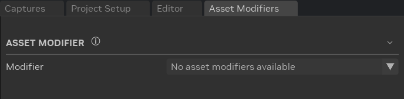
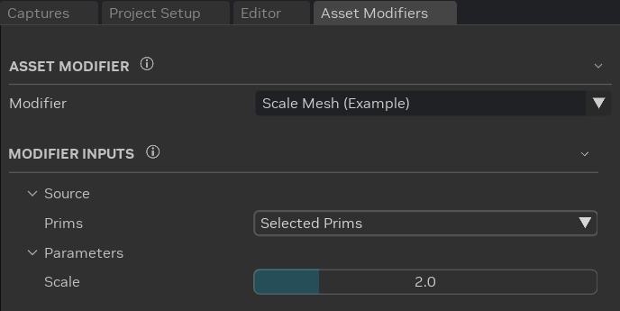
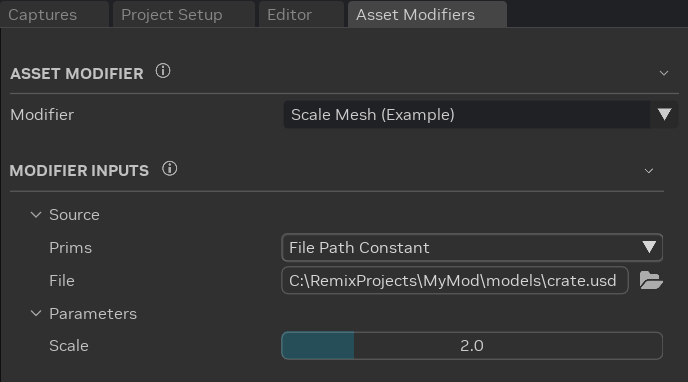
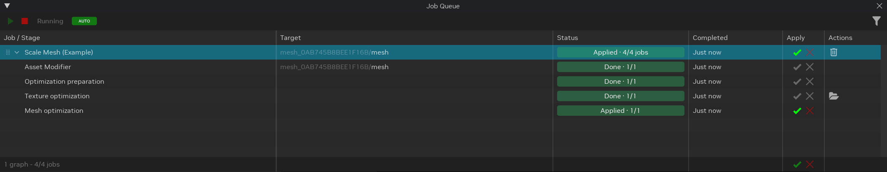
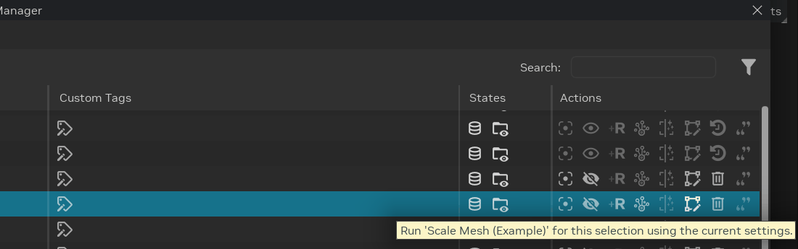
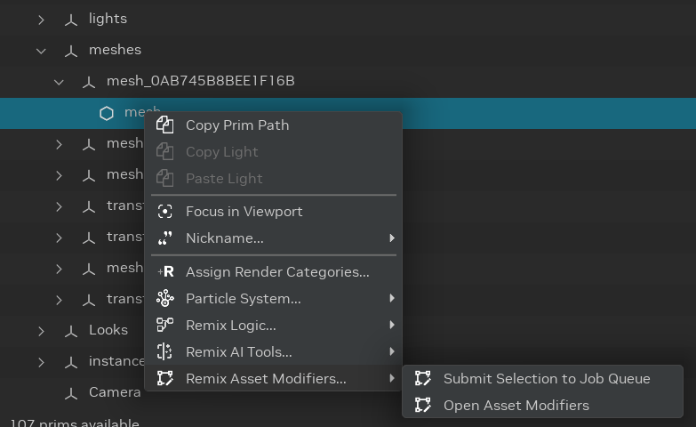

# Using Asset Modifiers

An **asset modifier** transforms a model on your computer, for example to scale a mesh or to rebuild it from its
textures. It needs no AI and no ComfyUI. The Toolkit runs the modifier in the
[Job Queue](../toolkitinterface/remix-toolkitinterface-jobqueue.md), processes its output like any ingested asset, and
replaces the model in your project. You can revert the change at any time.

```{note}
The Toolkit does not include a modifier. Modifiers come from extensions that you install. Until an extension provides
one, the **Asset Modifiers** window shows **No asset modifiers available**.
```



## Opening Asset Modifiers

- **Modding layout:** the **Asset Modifiers** tab is next to the **Editor** tab.
- **Stage Manager:** right-click a prim, then select **Remix Asset Modifiers...** > **Open Asset Modifiers**.
- **Any layout:** select **Window** > **Modifiers** > **Asset Modifiers**.

## Choosing a Modifier and Its Inputs



1. In **Asset Modifier**, select a modifier in the **Modifier** dropdown. Hover over a modifier to see what it does.
   A modifier marked **(Experimental)** may change in future versions. Check its output before you keep it.
2. In **Modifier Inputs**, set **Prims** in the **Source** group to choose the models to modify:

   | Prims | Models that the modifier changes | Result |
   |-------|----------------------------------|--------|
   | **Selected Prims** | The models of the prims that you select in the viewport or the Stage Manager. | Replaces the model reference of each prim. |
   | **All Compatible Prims** | The models of every prim in the project that the modifier accepts. | Replaces the model reference of each prim. |
   | **File Path Constant** | The model file in the **File** row. | Publishes the modified model. The project does not change. Works without an open project. |

3. Set the other inputs of the modifier. Hover over an input to see what it does.

The Toolkit remembers the selected modifier and the value of each input, also after a restart.

Each modifier decides which prims it accepts, for example meshes or materials. A prim must also come from an external
model, for example a captured mesh or a replacement that references a model file. Prims inside a referenced model are
skipped.



## Running a Modifier

1. If **Prims** is **Selected Prims**, select one or more prims in the viewport or the Stage Manager.
2. Click **Run Modifier**. Hover over the button to see why it is unavailable, for example when no project is open or
   the **File** does not exist.
3. The **Preparing Asset Modifier Jobs** window shows the progress while the Toolkit reads the project. Click
   **Cancel** to stop without adding jobs.
4. A notification tells you how many jobs were added to the Job Queue. If some prims were skipped, it gives the
   reason, for example **Not supported by** the modifier. Select **Open Job Queue** in the notification to see the
   jobs.

   

Prims that use the same model share one job, so each model is modified once.

## Following the Jobs in the Job Queue

Each model becomes one job graph in the [Job Queue](../toolkitinterface/remix-toolkitinterface-jobqueue.md). The graph
has the name of the modifier, and the **Target** column shows the prims that it changes, or the model file of a
**File Path Constant** source.



The first stage, **Asset Modifier**, runs the modifier. The modifier chooses the stages that follow. A modifier that changes a mesh usually
adds **Optimization preparation**, **Texture optimization**, and **Mesh optimization**, like an ingested model. The last
stage holds the result.

- **Apply** replaces the model reference of each prim with the modified model. The Job Queue applies it as soon as it
  is ready in **AUTO** mode, or when you select **Apply** in **MANUAL** mode.
- **Revert** restores the original model reference. **Undo** (Ctrl + Z) also reverts an Apply.

Each job saves its files in its own folder, `assets/ingested/modifiers/<modifier>/<job ID>/` next to your project, so a
new run never overwrites an earlier one.

See [Job Queue](../toolkitinterface/remix-toolkitinterface-jobqueue.md) for the statuses, the Apply buttons, the
filters, and **Job Details**.

## Running a Modifier from the Stage Manager

The **Actions** column of the **Prims**, **Meshes**, **Materials**, **Categories**, and **Custom Tags** tabs has an
**Asset Modifiers** icon. Click it to run the selected modifier on the selected prims with the current inputs.



The icon is enabled when **Prims** is **Selected Prims** and the modifier accepts the prim. Otherwise the icon is
disabled, and its tooltip says why. Click the disabled icon to open the **Asset Modifiers** window.

You can also right-click a prim and select **Remix Asset Modifiers...**:

- **Submit Selection to Job Queue** runs the modifier on the selected prims, like the icon.
- **Open Asset Modifiers** opens the **Asset Modifiers** window.



## Troubleshooting

| Symptom | Solution |
|---------|----------|
| The window shows **No asset modifiers available** | No installed extension provides a modifier. Install and enable an extension that provides one. |
| **Run Modifier** is unavailable | Hover over it to see the reason. Open a project, or select an existing model file for a **File Path Constant** source. |
| The Stage Manager icon is disabled | Set **Prims** to **Selected Prims**, or select a prim that the modifier accepts. Hover over the icon to see the reason. |
| A prim was skipped with **No external model reference composes this prim** | The prim does not come from a model file, for example it is a light or a prim inside a referenced model. Select its mesh or its replacement prim instead. |
| A job stays **Queued** | The Job Queue scheduler is stopped. Select **Start** (▶️) in the Job Queue toolbar. |

```{seealso}
To write a modifier, see [Add a modifier](../../source/extensions/lightspeed.trex.asset_modifiers.core/docs/README.md#add-a-modifier)
in the Asset Modifiers developer documentation.
```

***
<sub> Need to leave feedback about the RTX Remix Documentation?  [Click here](https://github.com/NVIDIAGameWorks/rtx-remix/issues/new?assignees=sambvfx&labels=documentation%2Cfeedback%2Ctriage&projects=&template=documentation_feedback.yml&title=%5BDocumentation+feedback%5D%3A+) </sub>
