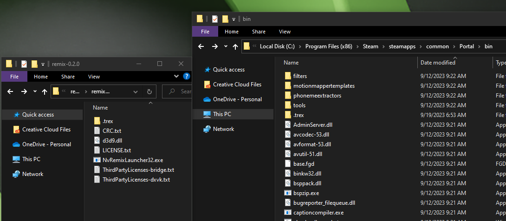
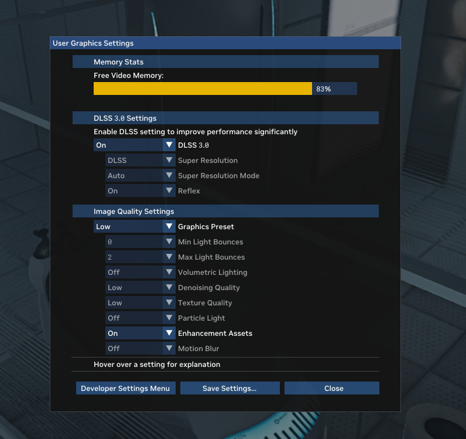

# Installing the RTX Remix Runtime

The RTX Remix Runtime is needed to play RTX Remix mods. **It is also included when you install the Toolkit.**

## Determining Your Game Platform

First you need to determine the platform your game was built for, i.e. whether it is a 32-bit game or a 64-bit game.
Most D3D9 games are 32-bit games, but modded or recompiled games might be 64-bit games. If you are unsure,
open the `Task Manager` while the game is running, switch to the `Details` view, and right-click a column header
and choose `Select columns` to enable the `Platform` column. Then check the value shown for the game's executable.

## Find the RTX Remix Runtime Bundled with the RTX Remix Toolkit

If you installed the RTX Remix Toolkit, the Runtime is already on your system.

To find it, go to the following folder:
<code>
[<INSTALL_DIRECTORY>](../remix-faq.md#how-can-i-locate-the-rtx-remix-toolkit-installation-folder)\deps\remix_runtime\runtime
</code>

Once you find the directory, you can follow the [instructions below](#installing-the-rtx-remix-runtime-for-your-game) to
install the Runtime for your game.

## Download from GitHub

For access to the latest, potentially unstable features, you can install the RTX Remix Runtime from GitHub.

Download the RTX Remix Runtime files from the
[latest GitHub release](https://github.com/NVIDIAGameWorks/rtx-remix/releases/).

Download `rtx-remix-for-x86-games-...` package for 32-bit games, or `rtx-remix-for-x64-games-...` package for 64-bit games.
The downloaded zip file contains the necessary files to prepare a supported game for RTX Remix. After unzipping, you
can follow the [instructions below](#installing-the-rtx-remix-runtime-for-your-game) to install the Runtime for your game.

```{tip}
DXVK-Remix sources and pre-release artifacts are on GitHub for users who want experimental renderer updates before they
ship in a full Runtime release:

[dxvk-remix](https://github.com/NVIDIAGameWorks/dxvk-remix/).
```

## Installing the RTX Remix Runtime for Your Game

### 32-bit Games

Once you have located the runtime directory or downloaded and extracted a package, you should find the following files:

```text
rtx-remix-for-x86-games
├── d3d9.dll                    # 32-bit Bridge client
├── .trex/
│   ├── NvRemixBridge.exe       # 64-bit Bridge server
│   ├── d3d9.dll                # 64-bit Remix Renderer/DXVK-Remix
│   └── ... (runtime dependencies, usd/)
└── .trex_arm64/
    ├── NvRemixBridge.exe       # ARM64 Bridge server
    ├── d3d9.dll                # ARM64 Remix Renderer/DXVK-Remix
    └── ... (runtime dependencies, usd/)
```

To prepare your game, start by copying the contents of the directory into the main game’s directory. The
`d3d9.dll`, `.trex/` and `.trex_arm64/` folders should end up sitting right next to the main game executable.

```{tip}
Removing the `.trex_arm64/` folder may reduce the mod size, but we do not recommend it, as it may impact performance on NVIDIA Spark.
```

### 64-bit Games

Once you have located the runtime directory or downloaded and extracted a package, you should find the following files:

```text
rtx-remix-for-x64-games
├── d3d9.dll                    # 64-bit shim: selects the implementation
├── d3d9_x64.dll                # 64-bit Remix Renderer/DXVK-Remix
├── d3d9_a64ec.dll              # ARM64EC Remix Renderer/DXVK-Remix
└── ... (runtime dependencies, usd/)
```

To prepare your 64-bit game, start by copying the contents into the main game’s directory. The `d3d9.dll` and
all other files and folders should end up sitting right next to the main game executable.

```{tip}
Removing the `d3d9_a64ec.dll` file may reduce the mod size, but we do not recommend it, as it may impact performance on NVIDIA Spark.
```

### Verifying Installation

Once RTX Remix files are in place, you can start the game normally. You can verify RTX Remix is working by checking for
the splash message at the top of the screen when the game starts. It should say: “Welcome to RTX Remix…” and
provide hotkey information to access the Remix menus.

```{warning}
Some games will search for `d3d9.dll` in a directory other than the directory of the main game executable. For example,
Source Engine games will search in the bin directory next to the main game executable for d3d9.dll instead.
```

```{seealso}
For more ways to verify that RTX Remix is working, see the
[Is My Game Being Processed by RTX Remix?](../remix-faq.md#is-my-game-being-processed-by-rtx-remix) section.
```

## Support for Other Graphics APIs

While support for D3D9 is included in Remix out of the box, games that use other graphics APIs can also be made to work
by utilizing translation layers that target D3D9. You will have to acquire these separately. For example, D3D8 games can
be supported through [D3D8to9](https://github.com/crosire/d3d8to9).

1. Open the folder that contains the source files of the game you wish to mod.
2. Locate where the executable (.exe) file is stored. This file is usually found inside a folder named "bin".
3. Copy and paste the Contents of the RTX Remix Runtime folder into the folder that contains the executable (.exe) file

   

4. Ensure that the d3d9.dll file from the RTX Remix folder copies over the d3d9.dll file in the game folder.
5. Now, run the game. If the Runtime has been installed successfully, you should be be able to open the **User Graphics
   Settings** Remix menu by pressing **Alt + X**.

   

```{tip}
If you are having trouble, try launching your game in Direct X v.7 or lower
```

***
<sub> Need to leave feedback about the RTX Remix Documentation?  [Click here](https://github.com/NVIDIAGameWorks/rtx-remix/issues/new?assignees=nvdamien&labels=documentation%2Cfeedback%2Ctriage&projects=&template=documentation_feedback.yml&title=%5BDocumentation+feedback%5D%3A+) </sub>
