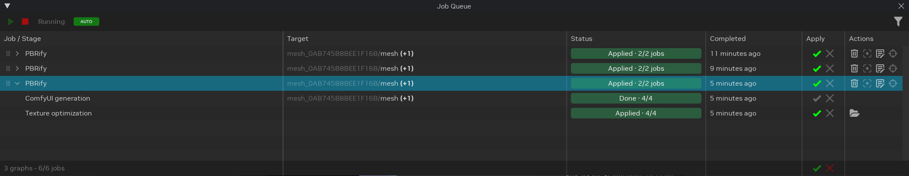
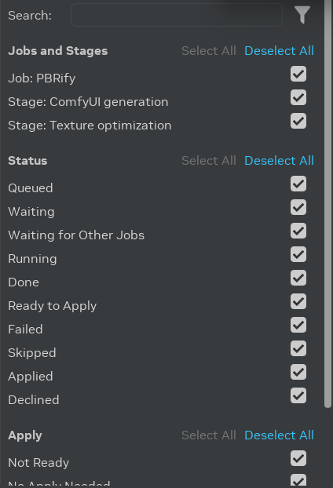
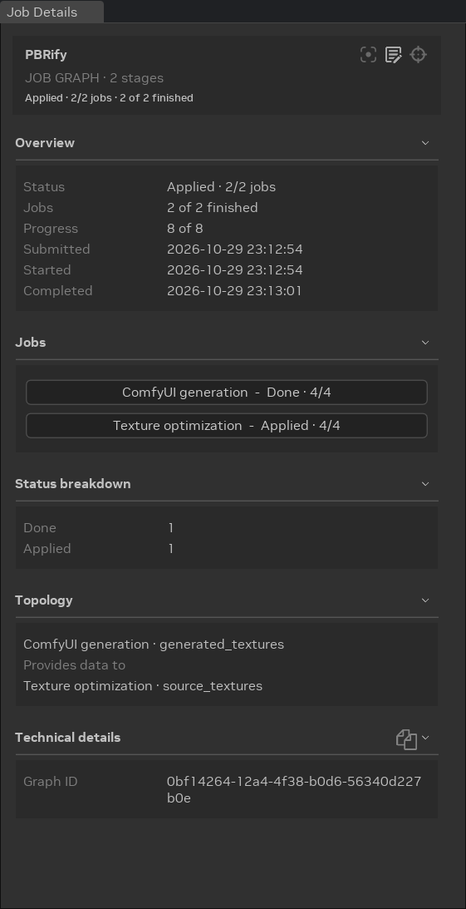

# Job Queue

The **Job Queue** lists the work that the Toolkit runs in the background, for example the
[AI Tools](../howto/learning-aitools.md) workflows and the [Asset Modifiers](../howto/learning-assetmodifiers.md)
that you run. You can keep editing your project while jobs run.
The queue shows the progress of each job, lets you apply or decline its results, and keeps its history across
restarts.

## Opening the Job Queue

- **AI Tools layout:** the **Job Queue** tab is below the viewport, next to **Stage Manager**. **Job Details** is on
  the right.
- **Modding layout:** the **Job Queue** tab is behind **Stage Manager**.
- **Any layout:** select **Window** > **Jobs** > **Job Queue** or **Job Details**.

## Job Graphs and Stages

One submission adds one or more **job graphs** to the queue. A job graph is one row in the queue. Click the arrow at
the start of the row to show its **stages**, the steps that run in order. For example, an AI Tools texture workflow
has a **ComfyUI generation** stage, then a **Texture optimization** stage. An asset modifier that changes a mesh runs
the modifier, then the optimization stages of an ingested model.

A stage starts when the stages before it finish. A graph changes your project only when a stage applies its result,
so a failed stage leaves the project unchanged.

| Column | Shows |
|--------|-------|
| **Job / Stage** | The name of the job graph, for example the workflow name, or the name of the stage. |
| **Target** | The prims that the job reads and changes, shown as the parent and the name, like the Stage Manager. **(+N)** counts the other prims. Hover over the cell to see every prim path. A graph row shows the target of its first stage that has one. |
| **Status** | The status of the stage, or of the whole graph with its finished job count. Hover over the status to see the reason. |
| **Completed** | When the job finished, for example **Just now**. Click a time or the column header to switch between relative and absolute times. |
| **Apply** | The **Apply** (✔️) and **Decline** (✖️) buttons. See [Applying Results](#applying-results). |
| **Actions** | The actions of the graph or stage. See [Row Actions](#row-actions). |

The footer shows the number of graphs and of visible jobs.

## Toolbar

| Control | Use |
|---------|-----|
| **Start** (▶️) | Starts sending queued jobs to run. |
| **Stop** (⏹️) | Stops sending new jobs. Jobs that already run continue until they finish. |
| **Running**, **Stopping**, **Stopped** | The scheduler state. **Stopping** waits for the running jobs to finish. Hover over it to see which graphs still run. |
| **AUTO** / **MANUAL** | The Apply mode. Click the badge to switch. **AUTO** applies each result as soon as it is ready. **MANUAL** waits for you to select **Apply**. |
| **Filter** | Opens [Additional Filters](#filtering-jobs). |

The scheduler runs and the Apply mode is **AUTO** by default. The Toolkit remembers both settings across restarts.

## Job Statuses

| Status | Meaning |
|--------|---------|
| **Queued** | The job waits for its turn to start. |
| **Waiting** | The job waits for the stages before it, or for something else, for example a ComfyUI server. Hover over the status to see the reason. |
| **Running** | The job runs. The status shows its progress. |
| **Done** | The job finished. It has no result to apply. |
| **Ready to Apply** | The job finished, and its result waits for **Apply**. |
| **Applying...**, **Reapplying...**, **Reverting...** | The Toolkit changes the project. |
| **Applied** | The result is in the project. |
| **Partially Applied** | Some results of the graph are applied and others are declined. |
| **Declined** | The result will not be added to the project. You can still apply it. |
| **Skipped** | The job did not need to run, for example because the asset is already optimized. Hover over the status to see the reason. When the job still has results, you can apply them. |
| **Failed** | The job could not finish. Hover over the status to see the reason. |
| **Timed Out** | The job did not finish before its timeout. Select **Retry** to run it again. |
| **Stopped** | You stopped the job before it finished. Select **Retry** to run it again. |
| **Apply Failed**, **Reapply Failed**, **Revert Failed** | The Toolkit could not change the project. Select the same button again to retry. |
| **Unavailable** | The feature that the job needs is not loaded. |

## Applying Results

A finished job that changes the project shows **Apply** (✔️) and **Decline** (✖️):

- **Apply** adds the result to the project. After that, the buttons become **Reapply** (✔️) and **Revert** (✖️).
- **Decline** keeps the processed files but does not change the project. You can still select **Apply** later.
- **Revert** asks for confirmation, then restores the project values from before the result was applied. The
  processed files stay on disk, so you can select **Reapply** later.

The buttons on a graph row act on every matching stage of the graph. The buttons in the footer act on every matching
job in the queue, from top to bottom. "Matching" means the jobs that the current filters show.

When a button is unavailable, hover over it to see why. For example, a result cannot be applied while its project is
closed.

## Row Actions

A graph row has these actions:

- **Delete** removes the graph, its jobs, and their output files after you confirm. Changes already applied to the
  project stay. You can also select graphs and press **Delete**.
- **Stop** replaces **Delete** while a stage of the graph runs. It stops the running stage, which then shows
  **Stopped**.
- The actions of the job type, for example **Focus in Viewport**, **Open Workflow**, and **Retarget** for
  [AI Tools jobs](../howto/learning-aitools.md#managing-ai-tools-jobs).

A stage row can have these actions:

- **Retry** runs a **Timed Out** or **Stopped** stage again with the same inputs.
- **Reveal in File Explorer** opens the processed textures folder of a **Texture optimization** stage.

Drag a graph by its handle at the start of the row to change its place in the queue. Queued graphs start in the order
of the queue.

## Filtering Jobs

Click the **Filter** icon in the toolbar to open **Additional Filters**.

- **Search** shows the jobs and stages whose name contains the text.
- **Jobs and Stages** shows only the checked job names and stage names.
- **Status** shows only the checked statuses. **Failed** also includes **Timed Out**, **Stopped**, and the failed
  Apply statuses.
- **Apply** shows only the checked Apply states: **Not Ready**, **No Apply Needed**, **Ready to Apply**, **Applied**,
  and **Declined**.

Each section has **Select All** and **Deselect All**. Click **Reset All** to remove every filter. The **Filter** icon
changes color while a filter is active. A graph stays visible while one of its stages matches.

## Job Details

Select a graph or a stage to show its information in the **Job Details** window.

For a **job graph**, Job Details shows:

- **Overview:** the status, the finished job count, the progress, and the submitted, started, and completed times.
- **Jobs:** each stage with its status. Click a stage to show its details.
- **Status breakdown:** the number of stages in each status.
- **Problems:** the stages that failed, with their reasons.
- **Topology:** which stage provides data to which other stage.
- **Technical details:** the graph ID.

For a **stage**, Job Details shows:

- **Overview:** the status, the reason, the progress, the source, and the times.
- **Logs:** the messages that the stage wrote. Click the copy icon to copy them.
- The sections of the job type. For example, an AI Tools **ComfyUI generation** stage shows its **ComfyUI server**, and
  a **Texture optimization** stage shows its **Processed textures**.
- **Inputs** and **Outputs:** the values that the stage received and produced. Click the folder icon in a section
  header to open the folder of those files.
- **Topology** and **Technical details:** the stages that it provides data to or runs before, and its IDs and errors.

## Job Persistence

The queue is saved on disk. If you close the Toolkit while jobs are queued, they are still in the queue when you start
it again. Start the scheduler to continue them. Deleting a graph is the only way to remove it from the queue.

***
 Need to leave feedback about the RTX Remix Documentation?  [Click here](https://github.com/NVIDIAGameWorks/rtx-remix/issues/new?assignees=sambvfx&labels=documentation%2Cfeedback%2Ctriage&projects=&template=documentation_feedback.yml&title=%5BDocumentation+feedback%5D%3A+) 
