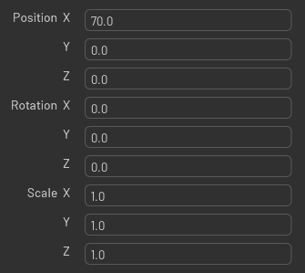

# USD Property Widget Model

Build property rows backed by USD attributes, with layer-aware writes, undo, and USD change listening.

## Responsibilities

- Read and edit scalar, vector, and virtual USD attributes across the selected prims.
- Keep property rows synchronized with USD and expose their reset and override state.
- Preview numeric drags live while preserving one undoable change on release.
- Build logical Curve/Gradient rows with USD-backed models and editor controls.
- Own grouped undo, edit failure recovery, and listener-driven value refresh.

## Non-Responsibilities

Numeric widget input and bounds belong to the shared property delegates and widget utilities. Stage Manager owns its
tree refreshes; this extension participates in the shared USD notice deferral used during property interactions.
Clipboard parsing, matching, structural checks, and paste grouping belong to the
[shared property widget helper](../../omni.flux.property_widget_builder.widget/docs/README.md#clipboard-and-row-editing).
Popup lifetime, selection observation, and generic Gradient controls belong to shared widget extensions.
Curve editing and channel selection belong to [the curve editor](../../omni.flux.curve_editor.widget/docs/README.md).
The shared property widget owns tree layout and field cleanup registration.

## Architecture

`USDModel` owns property items and the interaction lifecycle. Attribute value models read and write USD through the
existing commands. `USDListener` routes USD changes back to the model. The delegate builds the corresponding controls.
`USDModel` also supplies logical-group rows, `USDDelegate` claims them through field builders, and
`USDPropertyWidget` connects the tree to layer notices. Models own USD synchronization and undoable authoring.
Whole-color properties convert to their matching Gf vector type; numeric vector channels retain scalar conversion.

You can show custom names for attributes. For example here, `translateY` is just `Y`:



### Numeric Drag Preview

During a numeric batch edit, value models coalesce input into one preview on the next Kit update. Preview commands run
with undo disabled. Command history still records these previews; tests must inspect the undo stack and exercise
Undo/Redo rather than count command-history entries. SDK `UsdLayerUndo` reservations are indexed by effective layer and
mapped property path, capturing each original property spec once per gesture, including related properties. Each
reservation is restored independently. Property and Stage Manager notifications stay deferred through the interaction.

On release, pending preview work is cancelled, the original specs are restored, and the final cached value is written
through the existing commands. An undo group opens only when a target actually changes, so cancellation and unchanged
gestures preserve redo history. Cancelling, replacing items, or destroying an item or model restores the original
authored state without a final write. Item teardown calls each value model's `destroy()` hook to cancel its preview.
Multi-selection and vector editing retain their existing value and targeting semantics.

Restoration attempts every reserved property, reports failures, and retains only unsuccessful reservations. While
restoration remains unresolved, new edits and repeated release attempts raise an error before changing cached values
or opening an undo group. Explicit cancellation or destruction retries the remaining reservations; successful recovery
refreshes cached values and allows editing again. Recovery state remains local to the owning value models.
Failed restoration aborts model destruction or item replacement, keeping the existing items and their reservations
reachable for an explicit retry.

Default virtual attributes support previews. Virtual attributes with custom creation callbacks keep release-only
writes because their callback may modify properties outside the model's reservation scope. Typed edits keep their
existing immediate-write behavior.

## Floating Property Editors

Curve, Gradient, and texture-preview controls use the shared
[`FieldPopupWindow` lifecycle](../../omni.flux.property_widget_builder.delegates/docs/README.md#floating-property-editors).

`CurveFieldEditor` owns a per-opening model and session; standalone `PropertyPrimvarCurveModel` keeps
`auto_begin_session=True`. `GradientFieldEditor` borrows the field model and preview but owns its session and controls.
Texture preview is sessionless and loads data on activation.

`CurveFieldEditor` retains its editor widget and destroys it before its model during content release, so active
numeric edits finish while storage is still available. The shared popup lifecycle defers active close cleanup to
the next update; the release hook also handles canceled or partial builds. Repeated cleanup is safe.

Replace `UsdColorGradientWidget` with `ColorGradientField(model, model.group_ids[0], context_name=item.context_name,
pre_open_fn=item.pre_open_callback).build_ui(item)`. Remove `mixed_group_ids` and `pre_open_callback` from
`PropertyGroupedKeysModel` construction, and `mixed_curve_ids` from `PropertyPrimvarCurveModel` construction.
Preparation stays on the item; the model no longer exposes `pre_open_callback`. Logical mixed rows remain,
and the model owns USD notices and writes.

Each Curve or Gradient model edit creates one undo command: `begin_edit()` snapshots each target without writing, and
`end_edit()` records changed payloads with the original values. Discrete `SetDataPrimvars` commands snapshot on their
own. Mixed targets share a logical row yet retain distinct undo values; unchanged edits add no history. Gradient picker
and time-field behavior is described in
[Gradient content edit lifecycle](../../omni.flux.utils.widget/docs/README.md#gradient-content).

During a Gradient marker or time-field mouse drag, Ctrl+Z and Ctrl+Y leave scene history unchanged and are not queued
for release. A changed gesture adds one undo entry on release; normal Undo then restores its starting state.

Curve field builders pass `edit_context_factory=lambda: omni.kit.undo.group(remove_if_empty=True)` to group
multi-channel toolbar edits and keyboard deletion, plus
`finalization_context_factory=model.create_finalization_context` for
[numeric key gestures](../../omni.flux.curve_editor.widget/docs/README.md#numeric-key-editing) and canvas drags.
The [editor hook contract](../../omni.flux.curve_editor.widget/docs/README.md#storage-backend) separates discrete actions
from gesture finalization.

`PropertyGroupedKeysModel.create_finalization_context()` returns a fresh context without consuming pending edits.
It returns `contextlib.nullcontext()` when there are no pending edits or none can produce a command. Otherwise it
returns `omni.kit.undo.group(remove_if_empty=True)` when a pending group's source target is readable and its complete
current per-target snapshot differs from the captured baseline. Exact comparison includes tangent and infinity data;
returning only the displayed source coordinates to their starting values can leave other targets changed.

The check runs synchronously immediately before the existing `end_edit()` calls, which still consume the snapshots
and record commands. Unchanged gestures preserve pending Redo because they never open an undo group. Discrete actions
retain their unconditional grouping factory even while edit snapshots are pending. This context does not provide
transaction isolation for concurrent external edits or reentrant callbacks.

With the Curve popup focused, select keys and press Delete or numpad Delete to remove them. The shortcut follows
window focus even when the pointer leaves the canvas. Text and numeric fields retain Delete while editing; modified
shortcuts and key releases do not remove keys. Keyboard deletion uses the toolbar's selection rules and grouped undo,
and does nothing when no selected keys can be removed.

Numeric gestures keep model edits open while writing USD continuously. The editor clears its active gesture state,
then enters the finalization context only while synchronously closing those model edits. For a changed gesture, one
Undo restores each target's distinct original payload. The editor also handles Ctrl+Z cancellation of a held numeric
drag while preserving native text history. Self-authored notices and property-panel listeners retain their existing
suppression.

Genuine external notices invalidate numeric input and defer finalization and reload to a Kit update. This prevents
late field updates from applying an old gesture baseline, but retains the backend's existing concurrent-edit limits:
`end_edit()` records and reapplies the source target's current payload to all targets. An external change to another
target can therefore be replaced at finalization. Concurrent commands, structural edits, and authored-layer changes
are not isolated from the active edit.

## Curve Layout Styling

At property-control construction, the layout adapter resolves each leaf's `label_style_name` from the global
`omni.ui.Style` default dictionary's `Label::<name>` color. It forwards the name and the resolved `display_color`
for matching labels and curves without changing the source layout or writing display fields to USD.

Named colors, including `0`, override numeric fallbacks. Missing styles or colors preserve numeric fallbacks;
without one, group-color inheritance and editor defaults apply. Names are leaf-only. Load the application palette
before control construction; existing controls do not observe live theme changes.

See the [Curve Editor styling contract](../../omni.flux.curve_editor.widget/docs/README.md#channel-styling) for direct
editor consumers and selected-label styling.
### Edit Sessions

`begin_batch_edit()` coalesces numeric previews until `end_batch_edit()`. Pass `live=True` to author each value
immediately through one `LiveUsdAttributeEditCommand` that retains the initial layer specs for undo.
Live batches do not hold a Kit undo group open across frames and can participate in a caller-owned group.
Closing a live batch releases its command without authoring the cached value again. Ending an inactive batch does
nothing.
Field controls also pair `begin_edit()` and `end_edit()` around the session so `USDModel` can defer application
listeners until editing finishes while authored USD values remain live.

If a write fails, the model rolls back the current batch, restores displayed values, and preserves completed edit
sessions. Locked target layers are rejected before a write command runs. Color fields use one live batch per completed
drag or typed edit, pairing `begin_edit()` and `end_edit()` for each gesture. Opening the picker creates no undo entry.
Undo while the popup is idle restores the previous gesture and allows another edit in the same popup.
Row cancellation ends an active edit session and discards queued input while retaining field subscriptions.
`ColorField.cleanup()` releases those subscriptions; the default USD color builder
registers that cleanup with the owning delegate so a full row reset releases the field even when its backing value
model remains alive. Picker cancellation keeps the current field usable until that reset.
Row cancellation retains values already authored by a live batch; write failure rolls back the whole current batch.
An external change to an actively edited USD property, including global undo, cancels that edit, closes the popup,
and refreshes its value. Idle picker controls synchronize with restored USD values without creating an edit.
A lightweight USD notice listener observes these changes even while application refreshes are deferred.

Virtual color attributes retain their `create_callback(attribute, value)` creation hook. The first live preview
runs that hook in a synchronous undo group, together with the live color command. Callback setup commands and
subsequent color previews undo and redo as one operation; no undo group remains open between previews.
Creation callbacks must author their setup through Kit commands.

## Row-Owned Property State

USD property rows can represent one authored USD attribute or a logical group of companion attributes. The delegate asks each row for owned value models, owned attributes, row state, reset, and override deletion.

- Normal scalar rows use their own value models and USD attributes.
- Grouped rows, such as particle gradients, use suffix-based logical group definitions so `:times` and `:values` are handled as one row.
- Logical group outlets, such as particle curves, have no display value models but report their backing curve primvars. Their `read_only` property honors owned-model restrictions without treating an empty display-model list as a restriction.
- Active reset indicator tooltips show the default USD value when the row can resolve the value that reset will restore.
- Three-channel transform rows use synchronized link icons in both inter-field gaps. Their tooltips indicate whether multi-channel editing is on or off. Enabling them copies each represented object's X value to its Y and Z channels in one undoable edit, then activates a row-, label-, and links-highlighted grouped-edit state. The first field uses an inline text editor for immediate keyboard focus, and one validated field value is applied to every axis through a single USD write.
- Double-clicking any field while grouped editing remains active uses that field's native text editor without replacing the native drag behavior.
- Vector rows accept `tooltip_channel_names` when their components have semantic names instead of axis names.

### Logical Row Editing

`get_logical_row_attribute_names()` expands declared group IDs through `logical_group_definition` in suffix order,
then appends `logical_group_extra_attribute_names`. Standalone rows use their primary attribute's base name; outlets
use `edit_group_layout["curve_map"]` order. The clipboard helper and logical setter share this ordering rather than
deriving completeness from reset/delete ownership, which can omit missing attributes.

`_LogicalRowApiMixin.set_row_values()` delegates ordinary rows to `Item.set_row_values()`. Logical rows accept one
value per declared attribute, check cardinality, then use `ChangeProperty(prev=None)` in canonical attribute and target
order with USD notices deferred. Explicit undo restores prior edit-layer opinions, including inherited values without
leaving overrides. Unchanged animated values are skipped; legacy companions retain their always-author behavior.
The setter creates no editor, display models, or undo group. Clipboard paste or another caller owns grouping. Reported
command failure stops further writes; previously successful writes can remain applied until undone. Grouped editors
continue using `SetDataPrimvars` and their existing preview lifecycle.

Ordinary setters retain metadata, virtual creation, transform, bounds, and callback policies. USD dropdowns receive
labels without automatic numeric conversion; integer-backed setters translate labels to USD indices. Native typed
dropdowns retain their typed inputs. Clipboard-only model serialization, deserialization, and paste hooks are removed.
Texture-field change notifications validate the displayed path without blocking writes; manual begin/end editing owns
that blocking interval, so a programmatic refresh cannot prevent the following paste.

## Usage

```python
import omni.usd
import omni.ui as ui
from omni.flux.property_widget_builder.model.usd import USDAttributeItem as _USDAttributeItem
from omni.flux.property_widget_builder.model.usd import USDDelegate as _USDPropertyDelegate
from omni.flux.property_widget_builder.model.usd import USDModel as _USDPropertyModel
from omni.flux.property_widget_builder.model.usd import get_usd_listener_instance as _get_usd_listener_instance
from omni.flux.property_widget_builder.widget import PropertyWidget as _PropertyWidget

usd_listener_instance = _get_usd_listener_instance()

stage = omni.usd.get_context().get_stage()
prims = [stage.GetPrimAtPath(path) for path in ["/Root/my_prim"]]

valid_paths = []
items = []
# pre-pass to check valid prims with the attribute
for prim in prims:
    if not prim.IsValid():
        continue
    attrs = prim.GetAttributes()
    for attr in attrs:
        items.append(_USDAttributeItem(stage, [attr.GetPath()]))

property_model = _USDPropertyModel(stage, valid_paths)
property_model.set_items(items)
property_delegate = _USDPropertyDelegate()
usd_listener_instance.add_model(property_model)
with ui.Frame():
    property_widget = _PropertyWidget(property_model, property_delegate)
```

## Testing

The Curve editor named-context workflow reuses one USD context for the Kit process lifetime. Each run opens a fresh
stage and closes it during teardown, preserving stage isolation. Keep the native context alive because queued
`omni.kit.usd.layers` events can reference it after cleanup; destroying it can crash a later test. See the
[pipeline context lifecycle guidance](../../lightspeed.trex.asset_pipeline.core/docs/README.md) for the same constraint.
