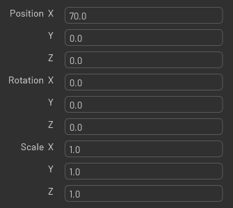

# Property Widget Builder

Build property panels from value models backed by USD, files, or other application data.



## Responsibilities

- Display name and value models in a property tree with reusable field builders.
- Coordinate row selection, expansion, hidden primary rows, and linked fields.
- Centralize clipboard parsing, matching, structural checks, and synchronous paste in `AttributeCopyPasteHelper`.
- Explain unmatched clipboard properties and report skipped, failed, or adjusted values after paste.

## Non-Responsibilities

Value models own conversion, bounds, callbacks, validity checks, and authoring. Feature panels own feature-specific dialogs.
The helper does not provide rollback or manage delayed callbacks.

## Architecture

`ItemModelBase` supplies names or values through `get_value()` and existing setters. `Item` holds the ordered
`name_models` and `value_models`; these lists need not have equal lengths. `Model` owns the row tree, and `Delegate`
selects field builders and renders its two columns.
`Item.value_type_name` is read-only and defaults to `None`; rows with a declared value type supply its name for
type-compatible clipboard matching.
`ItemModelBase.is_virtual` is read-only and defaults to `False`; virtual models set protected `_is_virtual` to `True`.
`ItemModelBase.set_value()` returns an `EditResult` from the existing setter/callback path: accepted, clamped,
rejected, or deferred, with the applied value and an optional explanation. A blocked setter or callback that retains
the edit reports deferred; its owner still controls completion and undo.

`Delegate` owns the shared `DragFieldGroupCoordinator`. Builders returning an `AbstractDragFieldGroup` set
`supports_field_cleanup=True` and `builds_drag_field_group=True` to receive cleanup and linked-row coordination.
Pixel-sized name columns adjust to panel size without redrawing rows for an unchanged width.

### Clipboard and row editing

`Item` inherits `AttributeCopyPasteHelper`. All includes hidden editable primaries, excluding structural groups and
claimed companions. `AttributeCopyPasteHelper` reads and matches each row through its existing property and model
interfaces, then collects setter outcomes in `PasteSummary`, defined alongside the helper in `clipboard.py`.
Paste All matches canonical property identities. Paste Selected uses `allow_name_mismatch=True` to map one ordinary
USD attribute to differently named attributes of the same declared type. Copied `type_name` metadata enables this
mapping and restores native vectors/colors; other rows retain identity matching. The destination editor applies hard
limits through its existing setter callback; soft drag ranges do not clamp.

`get_paste_unavailable_reason()` returns a matching explanation, or `None` when a paste attempt is eligible.
`can_paste()` retains the boolean availability API. The delegate uses the shared explanation for tooltips and owns
selection-specific prompts. Notifications report skipped, failed, or clamped values;
clamp warnings include requested and adjusted values. Details cover path/write failures and partial Paste All mismatches.
Copying, opening menus, and unadjusted successful pastes stay quiet. See the
[Understanding the Toolkit](../../../../docs/howto/learning-toolkit.md#copy--paste-values).

`paste(target_rows=...)` returns a `PasteSummary` containing submitted counts, identities, unmatched properties,
diagnostics, errors, adjustments, and deferred properties. The helper logs writer failures and shows its notification
once before returning the summary. The helper also owns the active Details popup; delegate reset and destruction call
`destroy_paste_details()` to release it. Deferred edits remain recorded in the summary; their existing confirmation
dialogs provide feedback without a separate waiting notification.
Writer failures retain their tracebacks in the summary and Console; earlier edits can remain applied.
Unexpected exceptions outside the writer's `RuntimeError`, `TypeError`, and `ValueError` failures still propagate.
Delayed callbacks retain their existing validation and undo ownership.
`read()` returns a snapshot reusable through `data=` on availability queries and `paste()`. Menus share it for
availability checks; paste clicks read fresh clipboard data.

Copy preserves defaults without authoring, raw logical backing values, and the last source's asset values; multichannel
rows copy one scalar per channel. The asset-path helper in
[Common Utilities](../../omni.flux.utils.common/docs/README.md#asset-path-context) preserves source locations.
Unknown relative sources are skipped with diagnostics. Asset paths reach existing edit callbacks as strings.
The helper passes anchored source locations unchanged; the USD value model owns destination formatting, validation,
and authoring. It follows the material path policy using each attribute's actual receiving layer and retains an
absolute path when that layer has no filesystem anchor or a relative path cannot be formed. `EditResult.value`
reports the applied path. Empty references clear textures, and generic assets need not exist. Paste transfers
references, not files.

`Item.set_row_values(prepared_values)` accepts a tuple with one input per value model. It checks cardinality and
refreshes each model immediately before calling its existing setter, returning their outcomes in model order.
Logical USD rows provide the only other setter
implementation; their [ownership and authoring](../../omni.flux.property_widget_builder.model.usd/docs/README.md#logical-row-editing)
remain in the USD extension. Button-only logical outlets remain eligible without fabricated display models.

The helper disables linked editing before applying an accepted row, preserving distinct copied components. Linking
stays off after undo. A row rejected during matching or by all its setters retains its link state.

One helper-owned native undo group combines synchronous command-backed writes across rows and destination prims.
It opens on the first eligible write attempt and removes an empty group. A standalone row setter does not promise
one undo action; its caller owns grouping when needed. Grouping does not guarantee rollback or make arbitrary
setters undoable.
Texture/import callbacks that write after paste returns retain their existing undo timing and validity ownership.

Version 3 removes row serialization/application methods, `Serializable`, value-model paste/deserialization hooks,
and the free-function clipboard entry points. Old clipboard envelopes are rejected. Use the helper for clipboard
operations and `set_row_values()` for general row application; no compatibility wrappers are provided.

## Usage

```python
from omni.flux.property_widget_builder.widget.tree.clipboard import AttributeCopyPasteHelper

AttributeCopyPasteHelper.copy(source_rows=source_rows)
AttributeCopyPasteHelper.paste(target_rows=destination_rows)
```

Custom value models can use `set_display_fn()` to format stored values without changing them.

`CallbackValueModel(value_type, get_value_fn, set_value_fn)` edits one value that its owner stores, such as a setting.
The model converts edited text to a `pathlib.Path` for a path value, shows an empty path as empty text, shows zero for a
value that does not convert to a number, and notifies its fields on change and on `refresh()`. It calls the setter
only when the value changed. Storage and validation, such as bounds or allowed values, stay in the owner's setter.

```python
from functools import partial

from omni.flux.property_widget_builder.widget import CallbackValueModel

value_model = CallbackValueModel(float, partial(settings.get_value, "scale"), partial(settings.set_value, "scale"))
```
`PropertyWidget.expand_all_groups()` and `collapse_all_groups()` preserve the requested expansion state across
deferred refreshes. See the [USD model](../../omni.flux.property_widget_builder.model.usd/docs/README.md) and
[file model](../../omni.flux.property_widget_builder.model.file/docs/README.md) for concrete integrations.
