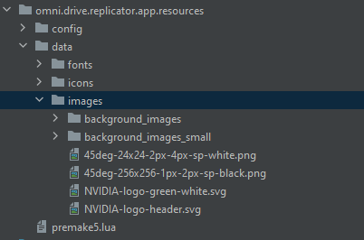

# omni.flux.utils.widget

Utilities to help to build Flux Widget(s)

## Responsibilities

- Provides Flux widgets, tree helpers, field controls, resource lookup, and reusable Gradient preview and editor content.

## Non-Responsibilities

- Does not own application resources, property-editor windows, or selection tracking.

## Architecture

This extension uses resources (icons, images, fonts, etc etc).
You need to set the setting `/exts/omni.flux.utils.widget/default_resources_ext` in your app, to let the module
find the resources.

Example:
```toml
[settings.exts."omni.flux.utils.widget"]
default_resources_ext = "omni.flux.app.resources"
```

Keep in mind that in your .kit file, your resource extension should starts first. Like:
```toml
"omni.flux.app.resources" = {order = -1000}  # should start first because of "default_resources_ext"
```

Your resource extension should have this type of architecture:




`data/fonts`

`data/icons`

`data/images`

`data/images/background_images`

## Gradient Content

`GradientPreview` holds image providers, time bounds, and full-precision fallback color. `render(keyframes)` updates
images without retaining keys or a model.

Inline and editor previews share these providers. Both call `GradientPreview.build_checkerboard()` to scale the
checker image uniformly and clip it to the bar. Each view owns its size callback, so resizing either view preserves
square cells without regenerating the shared texture. This handles omni.ui 3.1.3's `ImageWithProvider` aspect-crop
distortion. Cell size may vary with the bar's dimensions; the foreground gradient stretches across the bar so its
full color range remains visible.

Move `default_color` and `time_range` to `GradientPreview(default_color=..., time_range=...)`.
Construct `ColorGradientWidget(model, group_id, preview, read_only=...)` with keyword-only `read_only`, then call
`build_editor()` in the current UI container. `ColorGradientWidget` no longer accepts `title` or arbitrary UI keyword
arguments and no longer exposes `HEIGHT`; the caller owns window title and layout.
`destroy()` releases controls and subscriptions, leaving the caller-owned model and preview intact.

Marker drags and native time fields group each gesture into one edit. Picker changes update live and remain grouped
until close; application Ctrl+Z/Ctrl+Y checkpoints pending changes first. Native fields retain local undo; unchanged
picker sessions add no history, and the swatch survives model refreshes.

Property rows compose this content through
[ColorGradientField and FieldPopupWindow](../../omni.flux.property_widget_builder.delegates/docs/README.md#floating-property-editors).
For native color-picker dismissal restrictions, see the delegates extension's
[known limitations](../../omni.flux.property_widget_builder.delegates/docs/README.md#known-limitations).

## File Pickers

Directory file pickers return the highlighted directory when the user selects one. If no directory is highlighted,
they return the directory currently being viewed.

## Tree child state

`TreeItemBase.has_children` reports current structure and controls whether an existing branch is drawn.
`TreeModelBase.can_item_have_children()` is a capability hook that permits children by default. The
`TreeItemBase.parent` setter maintains links but does not enforce capability policy. TreeView uses `None` as its root
sentinel, so branch delegates guard it before reading `has_children`.
